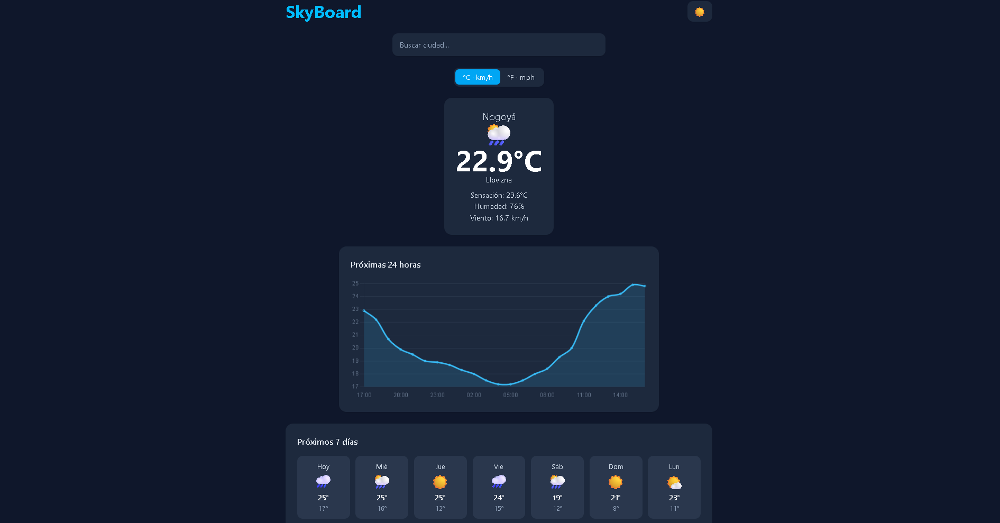
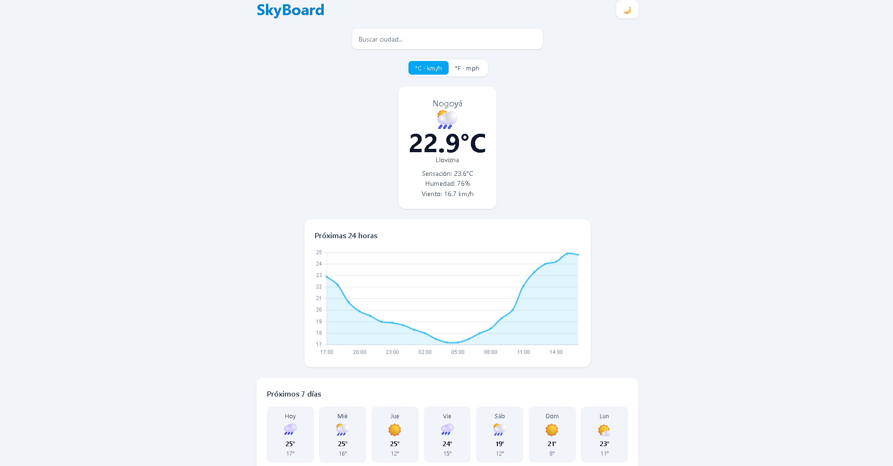

# SkyBoard 🌤️

Dashboard del clima construido con Vue 3 y TypeScript. Busca cualquier ciudad y consulta el clima actual, la temperatura de las próximas 24 horas y el pronóstico de 7 días.

**🔗 Demo en vivo:** [TU-ENLACE-DE-VERCEL](https://skyboard-seven.vercel.app/)




## Funcionalidades

- Buscador de ciudades con _debounce_ y cancelación de peticiones obsoletas
- Clima actual: temperatura, sensación térmica, humedad, viento y condición
- Gráfico de temperatura de las próximas 24 horas (Chart.js)
- Pronóstico de 7 días con máximas, mínimas e iconos
- Selector de unidades (°C · km/h / °F · mph) que recuerda tu elección
- Modo claro/oscuro, con el tema del sistema como valor inicial
- Diseño responsive y estados de carga y error

## Stack

| Área       | Tecnología                                          |
| ---------- | --------------------------------------------------- |
| Framework  | Vue 3 (Composition API, `<script setup>`)           |
| Lenguaje   | TypeScript                                          |
| Estado     | Pinia                                               |
| Estilos    | Tailwind CSS v4                                     |
| Gráficos   | Chart.js                                            |
| Build      | Vite                                                |
| Datos      | [Open-Meteo](https://open-meteo.com/) (sin API key) |
| Despliegue | Vercel                                              |

## Decisiones técnicas

- **Capa de servicios separada** (`src/api`): un cliente `fetch` común con manejo de errores, y funciones específicas para geocodificación y pronóstico.
- **Tipado de las respuestas de la API** con interfaces de TypeScript (`src/types`).
- **Estado de configuración en Pinia**: unidad y tema viven en un store y se persisten en `localStorage`, con manejo de errores si el navegador bloquea el almacenamiento.
- **Conversión de unidades centralizada** (`src/utils/formatters.ts`): los datos se piden siempre en métrico y se convierten al mostrarlos.
- **Búsqueda eficiente**: _debounce_ de 400 ms y `AbortController` para cancelar peticiones anteriores.
- **Accesibilidad básica**: `aria-label` en controles y gráfico, `aria-pressed` en el selector de unidades.

## Estructura

```
src/
├── api/          # cliente HTTP, geocodificación y pronóstico
├── components/   # SearchBar, HourlyChart, DailyForecast, toggles
├── stores/       # Pinia (unidades y tema)
├── types/        # interfaces de la API
└── utils/        # formateo y códigos del clima
```

## Ejecutar en local

```bash
git clone https://github.com/TU-USUARIO/skyboard.git
cd skyboard
npm install
npm run dev
```

No necesita variables de entorno ni claves de API.

## Próximas mejoras

- [ ] Ciudades favoritas
- [ ] Geolocalización del navegador
- [ ] Tests con Vitest
- [ ] Soporte de idiomas (ES/EN)

## Autor

**Marcos** · [LinkedIn](https://www.linkedin.com/in/marcos-joel-sanchez-6b9a9a273/) · [GitHub](https://github.com/MarcosJSanchez02)
